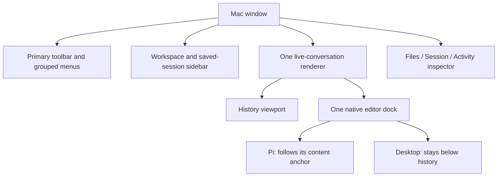

# Mac interface structure corrections

## Scope

The review used `main` at `ec19afa`, source files and hosted captures. The user authorized fixes for all six findings. These changes affect Mac presentation and navigation only. They do not add a runtime, change the shared protocol or alter iPhone behavior.

## Finding ledger

Findings 1–3 were P2 correctness defects. Finding 4 was a source-supported state-retention risk. Findings 5–6 were authorized UI design changes. All six are implemented; none is deferred.

| Finding | Evidence and effect | Implemented outcome | Focused evidence |
|---|---|---|---|
| 1. Unreachable Session actions | `sessionHeader` appeared only for an unloaded session, while its menu required that session to be loaded. | A reachable Session menu groups controls, Rename, Tree, History, diagnostics, directory copy and Close. Actions stay scoped to the displayed session. | Native menu contents/actions, actual Rename field, stale focus/context actions and working Close/Cancel tests pass. |
| 2. False empty Session inspector | From Overview/Settings, the focus guard rejected the active session and displayed “No loaded session.” | The guarded inspector names the actual active session and offers View active session. Navigation does not activate Pi. | Tests cover Overview, Settings and another saved row, actual Session-tab selection, navigation and unchanged host state/draft. |
| 3. False Activity success | Activity inferred success from `!isError && !streaming`, ignoring typed interrupted or uncertain outcomes. | Activity uses `PiToolRowValue` for action, target and status. It does not infer success from a closed stream. | Native Activity checks cover running, completed, failed, interrupted, unconfirmed and legacy output. |
| 4. Duplicate live-conversation routes | `.conversation` and `.session(selectedID)` rendered different branches for the same runtime. | Both aliases use one stable renderer. Loading blocks input without replacing it. | Native identity, undo, UTF-16 selection, marked text, completions, draft, disclosure and reading-position checks pass in both modes. |
| 5. Flat, duplicated toolbar | Files/Commands appeared beside a menu that repeated them, with many equal-level management buttons. | New/Stop and Files/Pi commands stay visible. Session groups session actions; Actions groups app management and remote access. Closed-menu shortcuts keep separate command ownership. | Actual native menu selection, closed-menu shortcuts, toolbar bounds at 900/1300 points, remote popover and preserved runtime checks pass. |
| 6. Desktop input scrolls away | Desktop shared Pi's transcript/editor/footer scroll placement. This was a design limit, not a dispatch defect. | Desktop reserves a separate history viewport above a persistent dock. Pi follows its content anchor. Both use the same native editor. | History/input geometry, independent scrolling, oversized widgets, Pi wheel routing, mode/IME/completion retention and Desktop reading during output checks pass. |

## Ownership



`MacWindowPresentation` in `CompanionWindow.swift` owns window-local inspector selection, dialog targets and remote-popover state. The observable reference keeps lazy menu and sheet closures current. It does not persist settings or change host state. Native checks exposed stale value-state presentation; a model action alone was not proof that the correct tab or dialog appeared.

The editor stays in one dock subtree. Pi reserves a measured placeholder in history and follows its position. Desktop reduces the actual history viewport and pins the same dock below it. Dock content above 75% of available surface height has internal scroll access. Extension widgets keep their above/below-editor order; the footer remains in the dock.

Pi's view-owned local wheel adapter forwards only unconsumed vertical events over that visible dock to its history. Editor, completion and oversized-dock scrolling consume first. Desktop, modified/horizontal events, other windows, sheets, modal or disabled/hidden surfaces pass through. Weak references and detach/dismantle/isolated-deinit cleanup bound the adapter's lifetime. It does not read or log input text.

Navigation to the loaded session does not send an activation request. The later [inspector review corrections](mac-inspector-review.md) also keep Files and Activity tab changes on the current destination and label their context. View active session provides explicit navigation. Actions retain existing context checks, idle rules, confirmation and no-replay behavior. Close still targets the focused session; changing focus does not silently close the new target. Rename/Tree/History reject a stale context.

## Source-review follow-up

Independent source review found one additional P2: the retained editor could accept native input while the loading surface was transparent. SwiftUI's disabled environment had not reached AppKit editability. `PiEditor.swift` now makes native input read-only while disabled. It blocks keyboard/action/completion routes and deferred completion requests, but still accepts synchronous parent draft restoration. Re-enabling refreshes completion and retries initial focus without replacing the editor.

All 30 focused checks pass in `disabled-editor-focused-final.log`: 29 native-editor tests plus loading checks across both modes, both live aliases and both recovery phases. A follow-up source review confirmed the correction and found no new actionable defect. These are hosted checks, not normal-app or real-IME-pointer evidence.

## Verification

All **231 configured Mac tests pass in three isolated batches**, including the input-disable correction. This is not a single-process full-suite pass.

| Check | Result | Log under `/tmp/pi-mac-interface-structure/` |
|---|---|---|
| Presentation, excluding the two separately run menu methods | 57 passed | `verified-presentation.log` |
| Two legacy native-menu methods in a clean host | 2 passed | `verified-native-menus.log` |
| All other configured Mac tests | 172 passed | `verified-other-mac.log` |
| Unsigned Mac build | Passed | `verified-build.log` |

`verified-coverage.json` matches all 231 expected test identifiers, with zero failures, skips, duplicates, omissions or unexpected tests. All 32 Mac source/test/project hashes match before and after the checks. `git diff --check` and 111 local documentation links pass. No compiler/build warnings appear in these final logs. Runtime SceneStorage, AppKit transaction, Picker, system-service, task-port, text-layout, FileIDMap and cancelled-connection diagnostics remain; `verified-summary.txt` records them.

Focused evidence includes `root-final-focused.log` (12 structure tests) and `focused-6.log` (mode, layout and interaction tests) under `/tmp/pi-mac-interface-structure/`. Earlier failed logs remain in that directory. The first complete two-batch attempt passed 226 of 228 tests. Two older native-menu fixtures failed while restoring application policy between windows and leaving a popover open. Their native hosting, regular-policy scope and explicit popover dismissal were corrected; both pass in `legacy-menus-final.log`. Initial checks also found the lazy-state presentation issue, dock top-alignment error, missing Pi wheel ownership and native-menu shortcut registration. These were corrected. Test-fixture fixes use valid private managed sessions, actual AppKit menu tracking/selection, visible native UI assertions and scoped window cleanup. Tests do not call a parallel action dispatcher to simulate menu success.

### Repeat the complete Mac checks

`project.yml` defines the scheme and source lists. Run `xcodegen generate` when source lists change. The three complementary batches below cover every configured test. The two legacy native-menu methods use a clean test host, separate from the legacy raster captures. Each command stays below the 300-second harness limit. This is process isolation, not permission to omit either menu test.

```sh
DEVELOPER_DIR=/Applications/Xcode.app/Contents/Developer xcodebuild test \
  -project PiRemote.xcodeproj -scheme PiRemoteMac \
  -destination 'platform=macOS,arch=arm64' -derivedDataPath /tmp/pi-remote-pi-like-mac \
  -parallel-testing-enabled NO -only-testing:PiRemoteMacTests/CompanionPresentationTests \
  -skip-testing:PiRemoteMacTests/CompanionPresentationTests/testRemoteAccessDetailsOpenFromRenderedSummaryAtBothWindowSizes \
  -skip-testing:PiRemoteMacTests/CompanionPresentationTests/testReviewIdleMenuCloseKeepsHistoryAndFlushesDraftBeforeHiding \
  CODE_SIGNING_ALLOWED=NO

DEVELOPER_DIR=/Applications/Xcode.app/Contents/Developer xcodebuild test \
  -project PiRemote.xcodeproj -scheme PiRemoteMac \
  -destination 'platform=macOS,arch=arm64' -derivedDataPath /tmp/pi-remote-pi-like-mac \
  -parallel-testing-enabled NO \
  -only-testing:PiRemoteMacTests/CompanionPresentationTests/testRemoteAccessDetailsOpenFromRenderedSummaryAtBothWindowSizes \
  -only-testing:PiRemoteMacTests/CompanionPresentationTests/testReviewIdleMenuCloseKeepsHistoryAndFlushesDraftBeforeHiding \
  CODE_SIGNING_ALLOWED=NO

DEVELOPER_DIR=/Applications/Xcode.app/Contents/Developer xcodebuild test \
  -project PiRemote.xcodeproj -scheme PiRemoteMac \
  -destination 'platform=macOS,arch=arm64' -derivedDataPath /tmp/pi-remote-pi-like-mac \
  -parallel-testing-enabled NO -skip-testing:PiRemoteMacTests/CompanionPresentationTests \
  CODE_SIGNING_ALLOWED=NO

DEVELOPER_DIR=/Applications/Xcode.app/Contents/Developer xcodebuild build \
  -project PiRemote.xcodeproj -scheme PiRemoteMac \
  -destination 'platform=macOS,arch=arm64' -derivedDataPath /tmp/pi-remote-pi-like-mac \
  CODE_SIGNING_ALLOWED=NO
```

### Captures and limits

Private hosted captures remain outside Git under `/tmp/pi-mac-interface-structure/captures/`: 12 paired Pi dark/Desktop light/Desktop dark captures at 900/1300 points, plus a 400 × 600 Desktop capture with older output and a long draft visible together. All 13 were visually reviewed for readable text, layout, toolbar/input/footer access and horizontal overflow. They are also XCTest attachments. No images are committed. The existing running app was not stopped or replaced.

The combined legacy presentation class remains order-dependent: its menu methods can time out after other captures, although they pass in a clean host. Failed combined runs remain recorded; the isolated partition does not prove that combined ordering is reliable. The former combined idle-close loop now has separate row/menu/inspector test cases with the same history/draft assertions.

These checks do not establish normal-launch/provider, live VoiceOver/full keyboard traversal or final user visual acceptance. The wheel tests exercise native forwarding and monitor cleanup, not installed-monitor delivery through a real trackpad gesture or momentum sequence. Desktop streaming-position checks use explicit user disclosure/reading intent and synthetic output. Real IME during pointer-driven mode switching remains a separate live check.

Host/shared/iPhone suites are not repeated for this Mac-only source change. Existing Mac model integration tests remain in the configured scheme. See [mode behavior](mac-interface-modes.md) and [extension boundaries](pi-extension-native-display.md).
