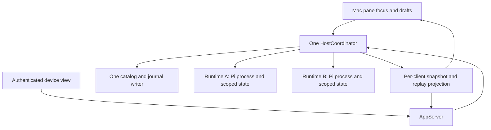

# Proposed independent session runtimes

## Status

Discovery for `docs/plans/2026-10-17_mac-session-management-plan.md`. This design is not implemented or verified. It changes the current shared-selection behavior and requires the compatibility decision described below before implementation.

## Current ownership

`HostCoordinator` holds one `RPCProcess`, `HostSnapshot`, transcript reducer, output-image store, replay stream, mutation set, lifecycle generation and dialog state. It also owns the instance lease, session catalog and request journal.

`AppServer` broadcasts that snapshot to every authenticated client. `RemoteClient` maintains one epoch/sequence checkpoint. `PhoneModel` and `CompanionModel` each display one runtime; an active-session replacement changes the shared snapshot. Existing Mac-model tests deliberately verify this shared local/remote behavior.

Starting another coordinator against the same support directory is not a concurrency solution. The instance lease rejects it; independent catalog or journal writers would race.

## Proposed ownership

Keep one host owner for the instance lease, executable configuration, directory registry, catalog, journal and runtime admission. A runtime owns its process, observer, generation, transcript, image/inspection caches, lifecycle state, dialogs, deadlines, notifications, mutation guard and recovery tasks.

Proposed admission bound: two loaded processes. Count idle, starting, stopping and unconfirmed-shutdown children against the bound. Do not evict or stop a session to admit another. Return the existing capacity failure when no slot is available.

Reserve both the managed app session ID and validated file identity before launch or lifecycle transfer. Keep reservations after uncertain shutdown. Release them only after confirmed process termination or confirmed transfer. Fork, clone, new and switch must not create a second writer for another runtime's session or delete a shared history folder during cleanup.

Every asynchronous operation must retain its runtime identity, generation and session binding. A continuation must not use the latest globally selected session after suspension.

## Compatibility decision

The version-1 encoding can still describe one runtime per phone, but preserving bytes alone is not enough. Current clients observe a shared selected runtime. The proposed behavior lets a Mac pane and each device retain independent selection.

Before implementation, obtain an explicit decision to change shared selection to independent device selection and accept the two-process bound. Do not change `PLAN.md`'s current single-runtime boundary before that decision. No background-service extraction is included.

After approval:

- Bind one stable runtime view to each authenticated device within a host epoch. Same-device connections share that device view.
- Give each device view one contiguous sequence and bounded replay buffer. Selection changes advance that view's sequence. Do not combine unrelated runtime sequence numbers.
- Route snapshots, synchronization, mutation reply state and broadcasts through the device view. Reconnection must not replay another device's state.
- Validate session actions against the device's displayed context and authoritative runtime, not Mac focus.
- Keep request-journal acceptance and deduplication before runtime allocation and execution. Preserve unknown outcomes and no automatic redispatch.
- Preserve existing busy lifecycle guards. A focus change must never implicitly stop another runtime.
- Retain the version-1 wire contract for the existing one-runtime phone interface. Any future multi-runtime phone UI requires explicit capability discovery; do not send additional runtime data without a negotiated contract.

## Mac panes

Initially allow two visible conversation panes. A pane references a session; it does not own a process. Reject duplicate visible session references to avoid competing editors and ambiguous keyboard focus.

Scope Send, Stop, attachments, slash completion, dialogs, drafts, undo, scroll position and inspector actions to the pane's captured session. Removing a split changes layout only. Close Session affects the chosen runtime and every view referencing that session, after the normal confirmation rules.

Viewing saved history must not start Pi. Starting or resuming a process remains explicit. The first UI implementation must not label a saved-only pane Idle or present an unrelated runtime's composer as ready.

## Shared state and risk controls

Pi's installed settings and authentication storage use locking in the inspected local runtime implementation. This source finding does not establish complete concurrent-child safety, particularly for autonomous credential refresh or extensions. Inspect and test the selected supported runtime before enabling concurrency. Never copy provider credentials into UI preferences or introduce isolated credential stores without a separate decision.

Two runtimes may edit the same project files. Show shared directory association; workspaces are not security sandboxes. No automatic worktree creation is included.

Keep aggregate memory limits for transcripts, images, replay, inspections and drafts; doubling runtimes must not silently double every unbounded cache. Scope image IDs, inspection cursors and request identities to runtime/session/generation.

## Required implementation checks

- Two distinct controlled child processes accept overlapping work.
- Stop, close, crash, event overflow and an unavailable directory in one runtime do not affect the other.
- Duplicate launch, lifecycle races and unconfirmed shutdown cannot create duplicate writers or release occupied slots early.
- Mac focus and two device selections remain independent; old-client reconnect/replay stays bound to the correct device view.
- Delayed replies, dialog IDs, images, attachments, inspection tokens, drafts and uncertain actions cannot cross sessions.
- Shared settings writes, resource exhaustion, authentication, revocation and orderly shutdown remain safe.
- Existing version-1 clients continue to decode state and use their displayed context correctly.

Affected test groups: host lifecycle and request journal, replay/overflow, images and inspection, authenticated transport, Mac model/presentation and focused primary-iPhone compatibility tests. Use controlled fixtures before installed-Pi checks. Do not use paid inference, real credential mutation or live session termination as implicit test setup.

## Recovery and downgrade

Companion exit must stop every owned child. Closing a window alone must not be described as stopping the companion. A restart can restore layout/session references but cannot restore the original process or prove interrupted tools completed.

Keep catalog and Pi JSONL formats unchanged unless discovery proves a migration is necessary. Before downgrade, stop all owned runtimes and preserve unknown-outcome records. Never run an older single-runtime host against live writers from a newer process.
