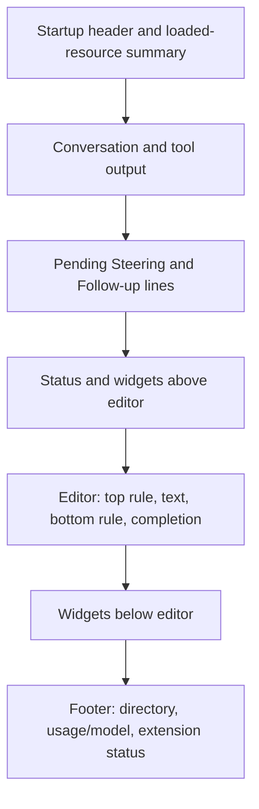

# Pi-like Mac interface reference

## Result and boundary

The installed reference is **Pi 1.3.0, built-in `dark` theme, `regular` TUI mode, with thinking collapsed**. This is a source-based reference for the [Mac interface plan](plans/2026-10-18_pi-like-mac-interface-plan.md), not proof that a native replacement is accepted. The [implementation and test record](pi-like-mac-verification.md) describes the new native surface separately.

Verified in this review:

- Installed `@earendil-works/pi-coding-agent` and `@earendil-works/pi-tui` package manifests both report `1.3.0`.
- A script selected only allowlisted display, interaction and keybinding fields. It did not print other settings, credentials, instructions or personal conversation content.
- Direct component `render(width)` calls work without `terminal.start()`, a Pi session or a provider request. Twenty synthetic checks passed, including width checks at 80 and 48 columns, tool expansion and slash-completion submission.
- No interactive process, provider call, upload, clipboard operation, personal history read or binary capture was used.

The user later supplied a 2191 × 593 startup reference and a 2240 × 216 extension-widget/footer crop after rejecting the first native layout. These establish the requested structure: startup logo/help, Context/Skills/Prompts sections, thin ruled input, two-line footer, and extension content in its own slots. No live terminal interaction, font measurement, invocation flags or extension configuration was inspected. The settings below remain saved-configuration evidence. Corrected native captures and final user review remain required; library renders are not normal-launch evidence.

## Sources

These installed paths were available during review. They are local evidence, not files shipped by this repository.

```text
/Users/narumi/.bun/install/global/node_modules/@earendil-works/pi-coding-agent/
/Users/narumi/.bun/install/global/node_modules/@earendil-works/pi-tui/
```

In the tables below, `agent/` and `tui/` mean these two package roots.

| Source | Reference responsibility |
| --- | --- |
| `agent/package.json`, `tui/package.json` | Installed versions |
| `agent/README.md`; `agent/docs/usage.md`, `configuration.md`, `settings.md`, `themes.md`, `keybindings.md`, `terminal-setup.md`, `tui.md` | Interactive interface, saved settings and renderer contracts |
| `agent/docs/cli.md`, `environment-variables.md`, `security.md`, `sessions.md`, `slash-commands.md`, `extensions.md`, `compaction.md` | Overrides, trust, sessions, commands and terminal-only behavior |
| `agent/docs/rpc.md`, `rpc-commands.md`, `rpc-extension-ui.md`, `json.md`, `message-types.md` | Native transport, queue, usage, shell, tree and standard dialog boundary |
| `tui/README.md` | Full component/renderer reference; direct `render(width)` contract |
| `agent/dist/modes/interactive/interactive-mode.js` | Startup, component order, submission, queue restoration, borders and selector replacement |
| `agent/dist/modes/interactive/tui-renderer.js`, `chat-viewport.js` | Regular versus fullscreen mounting |
| `agent/dist/modes/interactive/components/{custom-editor,user-message,assistant-message,tool-execution,bash-execution,footer,status-indicator,pi-logo}.js` | Main surface, message/tool styles and footer |
| `agent/dist/modes/interactive/components/{model-selector,thinking-selector,settings-selector,tree-selector,session-selector,extension-selector,extension-input,extension-editor,dynamic-border,keybinding-hints}.js` | Bordered pickers, standard interactions and hints |
| `agent/dist/modes/interactive/theme/{dark.json,theme.js,theme-tokens.js}` | Exact selected palette and color conversion |
| `agent/dist/core/{settings-manager,keybindings}.js`; `tui/dist/components/editor.js` | Defaults, input precedence and editor geometry |
| `agent/dist/core/tools/renderers/{read,bash,write,edit}.js` | Built-in tool presentation, separate from execution |
| `agent/examples/extensions/custom-footer.ts`, `modal-editor.ts` | Evidence that extensions can replace the built-in reference |

The relevant Markdown files above were read in full. The interactive JavaScript files were inspected at the relevant implementations. The examples were read without loading extensions. Repository baseline sources are [README.md](../README.md), [PLAN.md](../PLAN.md), [native compatibility](native-compatibility.md), `Apps/macOS/CompanionWindow.swift`, `Apps/Shared/ConversationView.swift` and `Packages/PiRemoteHost/Sources/PiRemoteHost/HostCoordinator.swift`.

## Effective non-secret configuration

User settings were selected from the agent directory resolved through `PI_CODING_AGENT_DIR`, falling back to `~/.pi/agent`. Project settings were selected from `/Users/narumi/src/pi-remote/.pi/settings.json`. Project inspection found no allowlisted overrides. This does not grant project trust or inspect the trust store. No settings manager was instantiated, so inspection could not save or migrate settings.

| Field | Saved selection | Effective reference without invocation/extension overrides |
| --- | --- | --- |
| `theme` | `dark` | Built-in `dark`, not the newer default `system` |
| `tuiMode` | `regular` | Main terminal buffer and terminal-owned scrollback, not fullscreen |
| `hideThinkingBlock` | `true` | Italic `Thinking...` placeholder; expand with Control-T |
| `terminal.hyperlinks` | `true` | Hyperlinks enabled; native links still require explicit activation |
| `markdown.mermaid` | `streaming` | Terminal renderer can transform Mermaid during streaming |
| `quietStartup` | Unset | `false`: compact header and loaded-resource details available |
| `editorPaddingX`, `outputPad` | Unset | 0 editor cells; 1 transcript cell on each side |
| `autocompleteMaxVisible` | Unset | 5 results |
| `showHardwareCursor` | Unset | `false`; `PI_HARDWARE_CURSOR` absent in the inspected process |
| `doubleEscapeAction`, `treeFilterMode` | Unset | `tree`, `default` |
| `steeringMode`, `followUpMode` | Unset | Both `one-at-a-time`; live state must come from RPC |
| `terminal.showImages`, `terminal.imageWidthCells` | Unset | `true`, 60 cells; protocol support still controls rendering |
| `markdown.codeBlockIndent` | Unset | Two spaces |
| Known keybinding actions | No configured overrides | Package macOS defaults; extensions can still intercept keys |

The inspected process reports `COLORTERM=truecolor`, `TERM=xterm-256color`, `TERM_PROGRAM=herdr`. This is the agent process environment, not proof of the user's normal terminal application. `--use-theme`, `--tui-mode`, `--verbose` and extension UI factories can change a live invocation. Fullscreen-only defaults do not describe the selected regular-mode reference.

### Safe selection method

The inspection parsed JSON in memory, then copied only these keys into a separate output object. It did not dump raw files or enumerate unknown setting values:

```text
Top-level allowlist:
  theme, tuiMode, quietStartup, editorPaddingX, outputPad,
  autocompleteMaxVisible, showHardwareCursor, hideThinkingBlock,
  doubleEscapeAction, treeFilterMode, fullscreenScrollbar,
  fullscreenCopyOnSelect, fullscreenWheelScrollLines,
  fullscreenExitOutput, steeringMode, followUpMode
Nested terminal allowlist:
  showImages, imageWidthCells, clearOnShrink, hyperlinks, images, trueColor
Nested markdown allowlist:
  codeBlockIndent, mermaid
Keybinding allowlist:
  Exact known action IDs from new KeybindingsManager().getEffectiveConfig()
```

The keybinding check selected only matching known IDs from `keybindings.json` and returned `{}`. It did not call `KeybindingsManager.create()` or read auth, model, MCP, resource, prompt or session files. Do not use `pi config`, debug dumps, credential-printing commands or broad environment dumps to reproduce this inspection.

## Palette

These are rounded 8-bit sRGB values produced by the installed library from `dark.json`. They are not colors sampled from a screenshot. The original values use OKHSL. A 256-color terminal can approximate them differently.

| Roles | sRGB |
| --- | --- |
| `text`, `userMessageText`, `toolTitle` | `#dee0e1` |
| `muted`, `toolOutput`, `customMessageText`, `mdLinkUrl`, `mdCodeBlockBorder`, `mdQuote`, `mdQuoteBorder`, `mdHr`, `toolDiffContext`, `syntaxComment`, `syntaxOperator`, `syntaxPunctuation`, `searchMatchText` | `#9da5a9` |
| `dim` | `#7e888e` |
| `accent`, `customMessageLabel`, `mdCode`, `mdListBullet`, `syntaxType` | `#a798d7` |
| `border`, `borderAccent`, `borderMuted` | `#5fa8cc`, `#a08ed5`, `#768186` |
| `success`, `mdCodeBlock`, `toolDiffAdded`, `syntaxNumber` | `#68b78d` |
| `error`, `toolDiffRemoved` | `#ea7f81` |
| `warning`, `mdHeading`, `syntaxFunction` | `#cd9a22` |
| `mdLink`, `syntaxKeyword` | `#69add0` |
| `syntaxVariable`, `syntaxString` | `#5db3ba`, `#de8d5a` |
| `thinkingText` | `#96a0a4` |
| `userMessageBg`, `selectedBg` | `#213b49` |
| `customMessageBg` | `#3a3055` |
| `toolPendingBg`, `toolSuccessBg`, `toolErrorBg` | `#34383a`, `#254131`, `#5b282a` |
| `scrollbarTrack`, `scrollbarThumb`, `searchMatchBg` | `#484e52`, `#97a0a5`, `#4e2f1b` |
| `thinkingOff`, `thinkingMinimal`, `thinkingLow` | `#6c767b`, `#68808d`, `#5489a4` |
| `thinkingMedium`, `thinkingHigh`, `thinkingXhigh`, `thinkingMax` | `#6185cc`, `#9776e5`, `#de54c1`, `#fe5462` |
| `bashMode` | `#5eb286` |

The logo uses fixed coral `#e48a7a`, blue `#4f8eb3` and yellow `#eab65d`, independent of theme. Its normal form is four cells wide and two rows high. Apple Terminal uses a colored `Pi` wordmark instead.

**The terminal canvas is not specified by `dark.json`.** Plain editor text and default assistant Markdown also use terminal foreground where no explicit style applies. Do not treat HTML `export.pageBg` or `export.cardBg` as terminal canvas colors. Native canvas, font family and point size need capture review; any chosen values are native design choices until then.

Color reproduction uses only library imports:

```js
const base = "/Users/narumi/.bun/install/global/node_modules/@earendil-works";
const { initTheme, theme } = await import(`${base}/pi-coding-agent/dist/modes/interactive/theme/theme.js`);
const { colorToRgb } = await import(`${base}/pi-tui/dist/index.js`);
initTheme("dark", false); // No theme watcher or terminal start.
for (const [name, color] of Object.entries(theme.colors)) {
  const { r, g, b } = colorToRgb(color);
  const hex = [r, g, b].map(v => Math.round(v).toString(16).padStart(2, "0")).join("");
  console.log(name, `#${hex}`);
}
```

## Layout and display rules

### Regular-mode structure

The built-in surface is a single column, not a workspace dashboard. Its order is:



Regular mode uses terminal scrollback. It does not reserve a terminal-height transcript viewport. The corrected native target uses one scroll flow through startup, conversation, extension slots, editor and footer. It must not add a viewport-sized blank gap before input. Native scroll storage remains a platform adaptation, not terminal scrollback. No persistent sidebar or Files/Session/Activity inspector exists in the built-in terminal surface.

Startup has one blank row before and after its header. The compact header includes version and interrupt, clear/exit, commands, shell and expand-help hints, followed by onboarding text. Control-O expands startup help and loaded resources together with tool output. Normal startup details can list loaded context/resource paths and conflicts; do not read personal resources to fabricate this list. The native startup must show only authoritative data it has, with unavailable details stated explicitly.

### Editor and pending work

- The editor has full-width `─` rules above and below text, with no side border, prompt glyph, chat bubble or Send button in the terminal component.
- Empty/one-line editing takes three rows. Padding is zero. At zero padding, wrapping reserves one column for the cursor. It grows with content up to `max(5, floor(terminalRows × 0.3))` visible text rows; hidden rows appear as `↑ N more` or `↓ N more` in the rules.
- The rules use the current thinking-level color; leading `!` or `!!` switches them to `bashMode`. Working, retry and compaction indicators can be embedded in the top rule. Narrow rules fall back to the spinner. The standard editor is created with `embedWorkingStatus: true` in both modes.
- Completion is **below the bottom rule**, before below-editor widgets/footer. It shows at most five results, an accent `→` selection and muted descriptions. Lists wrap or truncate to available columns.
- Pending rows are above the editor: `Steering: …`, then `Follow-up: …`, then `↳ option+up to edit all queued messages`. Each is a one-line, dim, truncated preview with one cell of padding. These are sensitive UI content, not routine logs.
- The terminal uses a reverse-video drawn cursor and a hidden hardware cursor position for IME. Native AppKit must retain its own selection and marked-text behavior; do not imitate ANSI cursor markers.
- Bracketed paste is one edit and does not execute embedded newlines. Large pastes can become `[paste #N …]` markers whose expanded text is submitted. Native multiline paste need not copy this storage representation.

### Conversation and tools

| Content | Built-in terminal display |
| --- | --- |
| User message | Full-width `userMessageBg`, one horizontal padding cell and one background-filled blank row above/below; Markdown with preserved ordered-list markers/backslash escapes |
| Assistant text | One blank row before visible content, one horizontal padding cell, trimmed Markdown, no panel background or role label |
| Thinking | Initially italic `Thinking...` in `thinkingText`; Control-T expands/collapses. Expanded reasoning stays italic and muted; blank row separates it from following text |
| Code and Markdown | Monospaced terminal grid; colored headings, links, inline code, fences and syntax; default code indentation is two spaces |
| Tool call | One outer blank row, then a padded pending/success/error panel with bold title/path or command. Built-in renderers differ; do not assume every tool is generic JSON |
| `read` | Successful output is hidden while collapsed; title remains. Error output remains visible. Expanded content uses syntax highlighting where possible. Skill/docs/instruction reads can use compact titles |
| Model-issued `bash` | Bold `$ command`, optional timeout; collapsed result keeps the last five **visual** output lines, plus hidden-earlier-lines hint. Expanded result shows all retained output; truncation and full-output notices remain explicit |
| `write` | Title/path and first ten content lines when collapsed; expanded call reveals retained content; errors remain visible |
| `edit` | Self-framed title/diff using added/removed/context colors; it can compute a terminal-local file preview. Native display must not claim this preview exists when RPC only supplies a final diff |
| Unknown tool | Generic name/arguments and text fallback; fallback results preview first ten logical lines. Terminal extension renderers can replace this |
| Direct `!` / `!!` | Separate ruled shell block, bold `$ command`, muted output; collapsed preview keeps up to twenty visual rows. `!` rules use `bashMode`; `!!` rules use `dim`. Shows cancellation, nonzero exit and truncation. This is not a model tool call |
| Error/abort/length | Visible error-colored text after partial output: `Error: …`, `Operation aborted`, or `Response was truncated before completion.` |
| Images | Terminal protocol-dependent inline image or fallback text; preferred width 60 cells. Native image viewing remains native and bounded |

### Footer and authoritative data

The built-in footer has two rows plus an optional extension-status row:

1. Dim current directory (`~` only within home), optional ` (git-branch)`, optional ` • session-name`; truncates with `...`.
2. Dim cumulative usage on the left, model/thinking right-aligned with at least two spaces. Tokens use `↑input ↓output RcacheRead WcacheWrite`; zero fields are omitted. Cache activity can add `CHn.n%`. Cost uses three decimals; subscription state can add ` (sub)`. Context uses `n.n%/window (auto)`, or `?/window (auto)` when unknown after compaction. Context above 70% is warning-colored; above 90% is error-colored. Provider prefix appears only if multiple providers and space permit. A routed virtual model can add an arrow and actual route.
3. Optional extension status values, sorted by status key, sanitized to one line and truncated. Their own styles can remain.

| Native datum | Authoritative path or explicit limit |
| --- | --- |
| Version, directory, execution/interruption state | Existing host runtime metadata and selected session; never substitute a hardcoded fixture in production |
| Model, thinking, queue modes/count, auto-compaction | `get_state`; model/thinking change responses/events |
| Full-session tokens, cost and current context | `get_session_stats`; null post-compaction usage stays unknown, not 0% |
| Session name | `get_state` / `session_info_changed`; never rewrite the stored name for display |
| Git branch | Not an upstream RPC footer field. Omit unless the host supplies a checked, session-bound local result |
| Cache-hit percentage, subscription badge, virtual-model route | Not all exposed as footer-ready state. Derive only from validated available data or omit; do not infer subscription from provider name generally |
| Loaded instructions/resource list, model scopes | No complete startup-resource getter. `get_commands` exposes command metadata, not every loaded resource or its contents. Do not scan private instructions to fill the header |
| Extension statuses and text widgets | Standard `setStatus` and `setWidget`; preserve above/below-editor placement where available |
| Replaced terminal header/footer/editor, custom tools | No RPC component transport. The built-in reference does not establish parity with an installed replacement |

## Behavior matrix: baseline to target

“Baseline” means the documented pre-redesign Mac behavior in README/PLAN and the compatibility review. Concurrent implementation and later test results must be recorded separately; this table is not a live app test.

| Reference action and expected result | Mac baseline | Proposed native target / deliberate limit | Validation |
| --- | --- | --- | --- |
| Startup/idle: compact version/help above transcript; editor rules and footer below | Light workspace sidebar, header, inspector and labelled composer | Dark single-column coding surface; workspace/files/settings remain secondary. Accurate unavailable states | Empty/populated, wide/narrow capture comparison |
| Return submits ordinary input; Shift-Return or Control-J inserts newline | Return inserts newline; Command-Return submits | Match terminal Enter/newline map. Marked IME text must never submit | AppKit key and composition tests; attended keyboard check |
| Slash list: Tab completes only; **Return completes and submits** | Tab/Return complete only | Deliberate native difference: Return/Tab completes only; press Enter again to execute. Preserve consent gates for destructive/external actions | `/mo` fixture; draft retained on rejection; unsupported builtin routing tests |
| File/path list: Return completes only; Tab completes; Escape dismisses | Slash suggestions and explicit file attachment; no equivalent general path completion | Native session-bound path completion with existing permissions/attachment limits; never execute completion | Spaces, Unicode, quoted paths, stale results and no-match fixtures |
| Up/Down moves cursor; at first/last visual row browses prompt history | Native editor movement | Keep local bounded prompt history and restore pre-browse draft. Explicit history bindings outrank model-cycle keys | Wrapped/multiline/history tests |
| Escape with completion open cancels list before interrupt | Dismisses native suggestions | Preserve precedence; dialogs own Escape before main editor; never Stop due to completion dismissal | Active run + completion/dialog tests |
| Escape during work restores queued text, then aborts | Stop clears queue and discards `clear_queue` text | Typed recovery flow described below; preserve existing explicit Stop semantics until accepted | Coordinator clear/abort order, races, lost-response tests |
| Option-Return queues follow-up while busy; Return queues steering | Explicit steering/follow-up selection | Keyboard equivalents with visible queue type; idle Option-Return acts like submit | Acceptance/handled/queued disposition and delivery-order fixtures |
| Option-Up restores all queued text without aborting active work | No native dequeue/editor recovery | `clear_queue` destructive read, bounded recovery offer, no automatic dispatch | Queue ordering, nonempty draft, cross-device and reconnect tests |
| Empty idle editor: double Escape within 500 ms opens tree by default | `/tree` opens read-only inspection | May open inspection, but must label in-place navigation unavailable | Keyboard timing test; no leaf mutation |
| `/tree`: navigate within same file, restore user text or continue after another entry; optional branch summary | Authoritative tree previews and separate fork/clone | Keep inspection and explicit fork/clone. No RPC `navigate_tree`; do not edit JSONL leaf or add an adapter | Tree preview/fork fixtures; unsupported navigation explanation |
| Control-L model; Shift-Tab thinking; Control-P next model | Native selectors/cycling with idle restrictions | Compact keyboard pickers; authoritative model/levels. Preserve host idle constraints. RPC cycle exposes forward only, so reverse cycling requires supported typed native selection or explicit exclusion | Picker navigation, state/read-back, busy rejection |
| Control-O tool/startup expansion; Control-T thinking visibility | Expandable native tools/thinking | Native display-only expansion with matching compact defaults; full retained output limits remain visible | Streaming, read/error, bash-tail, write and diff fixtures |
| `!command` / `!!command`: direct shell with/without next-prompt context | Approved shell workflow was unimplemented in the documented baseline | Upstream `bash` / `abort_bash`, typed consent, bounded streaming; `excludeFromContext=true` for `!!`. Never forward as a model prompt or spawn an app-owned shell | Correlated chunks/final result/cancel, stale session, truncation, uncertain outcome |
| Standard extension select/confirm/input/editor | Supported native dialogs; status/widgets not in terminal positions | Pi-like bordered native interaction; preserve timeout, cancellation, stale-answer and draft-replacement consent | Isolated standard protocol fixtures; no real extensions needed |
| `/resume`, `/new`, `/fork`, `/clone`, `/name` | Companion-managed controls | Keep lifecycle hooks, idle/conflict checks and managed ownership; never attach to a terminal-owned runtime | Existing lifecycle checks plus focused input tests |
| `/session`, usage/footer, retry/compaction status | Usage and runtime controls available separately | Surface only authoritative values; preserve unknown context and retry read-back limits | Empty, active, compacted, retry and unavailable fixtures |
| `/login`, `/logout`, `/trust`, `/reload`, custom terminal UI | No native terminal management equivalent | Explicit terminal-only guidance. Do not forward known unsupported builtins as ordinary prompts, run auth UI, modify trust or load extensions to simulate parity | Routing tests preserve draft and make no provider call |
| `/copy`, export/share, file/device/settings controls | Explicit native controls and consent | Preserve secondary access and local clipboard/export consent; no terminal automatic-selection copy requirement | Model tests; no clipboard/upload operation in this review |

### Keyboard precedence

Source order in `CustomEditor.handleInput` is: extension shortcut; clipboard-paste action; Escape (completion first); empty-editor exit; dedicated history actions; other application actions; base editor. The base editor processes completion navigation/confirmation before ordinary editing and submission. Fullscreen transcript navigation takes precedence at the renderer level, but it is not part of the selected regular-mode reference.

Unmodified Control-C clears first and exits on a repeated action; Control-D exits only with an empty editor and otherwise deletes forward. Native Quit must keep the app's active-work consent. Process suspension and external-terminal editor launching are not required native equivalents. Native Command-C/selection, accessibility and IME take priority over literal terminal control sequences where platform behavior requires it; retained differences need acceptance.

### Queue recovery boundary

There is **no non-mutating upstream RPC queue-text getter**. `get_state` supplies a count, not queued text. `queue_update` carries full current steering/follow-up arrays, but the existing host projection keeps counts, not a complete durable text mirror.

`clear_queue` is different: it removes pending work and returns `{steering: [text], followUp: [text]}`. It is an authoritative destructive read, not an inspection API. Terminal restoration concatenates steering texts, then follow-up texts, then the current draft, separated by blank lines. It does not reconstruct original mixed arrival order.

A supported native design can:

1. Clear the queue through a session-bound typed host action and bound/validate its returned text.
2. For Escape recovery, clear **before** abort and confirm settlement. Aborting alone can continue pending work. For Option-Up, do not abort.
3. Return an explicit recovery offer to the initiating editor. Preserve the current draft and require a decision before replacement. Keep recovered instructions unsent.
4. Fence generation/session changes and concurrent Mac/phone mutations. Retain an explicit unavailable/partial result if limits or an uncertain response prevent full recovery.

The explicit Stop path discards the returned text; the new recovery action returns it directly to the initiating controller. Counts, client drafts and old submitted text cannot prove what is still queued after expansion or extension input handlers. A lost destructive-read response cannot be repaired by repeating it or by automatically resending recovered text. No full queue recovery across a host restart is promised. This semantic change needs focused host tests and explicit acceptance; UI styling alone cannot implement it.

## Deterministic render checks and remaining captures

The successful noninteractive check used a plain stub `{terminal: {rows: 32, columns: 80}, requestRender() {}}`, `new KeybindingsManager()`, `setKeybindings(manager)` and `initTheme("dark", false)`. It instantiated built-in components directly; it did not construct `InteractiveMode`, a process terminal, a model runtime or a session manager backed by disk. The footer used synthetic getter objects. Renderers received synthetic `Fixture.swift`, `printf fixture`, thinking text and results; no command was executed or file read for those fixtures.

Verified results:

- User, collapsed-thinking assistant, error, collapsed read, collapsed model-bash, editor, footer, thinking selector and extension selector each fit 80 and 48 columns: 18 checks.
- Expanding read exposes the synthetic retained line: one check.
- Tab completion does not submit; Return on `/mo` completes and submits `/model`: one check.
- At 80 columns, the one-line editor has three rows; the synthetic footer has two; user message has three; collapsed read has four; the nine-line bash result has eleven with its five-line tail. At 48 columns, selector hints can wrap. These are library line counts, not native pixel requirements.

A representative synthetic footer at 80 columns is:

```text
/fixture (main) • Reference
0.0%/200k (auto)                                          fixture-model • medium
```

No screenshots or binary files were created or committed. The first exploratory script used a nonexistent `pi-tui.stripAnsi` export and failed; the corrected checks used `agent/dist/utils/ansi.js`. Source hints also require `setKeybindings(new KeybindingsManager())`; without it application key labels are absent from isolated renders.

The library check does not prove startup rendering with real resources, cursor/IME positioning, scrollback, streaming animation, native interaction or extension replacements. Avoid constructing `ModelSelectorComponent` merely to capture a fixture: its constructor starts a model-catalog refresh. Avoid marking edit arguments complete against a real path: its renderer can compute a local diff. Use synthetic native selector/diff fixtures or a strictly isolated harness instead.

Still required, with synthetic content and no provider request where possible. Startup and extension-crop references have been supplied; other states and final native acceptance remain open:

1. Additional attended/user-supplied terminal captures: startup, idle multiline editor, slash and path completion, active output, pending queues, tools collapsed/expanded, selectors and errors. Record terminal application, mode/theme, window size, cell dimensions or text size, and any extension replacement. Do not include personal conversation or credentials.
2. Paired native Mac captures of those states at normal and narrow sizes, plus attended keyboard/IME/selection checks. The parent implementation owns the native build and visual captures.
3. User review of layout, palette, interaction and every retained protocol/platform difference. Until then, reference capture and visual acceptance plan items remain open.
