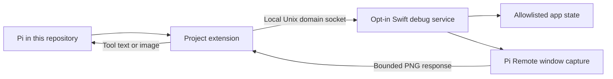

# Mac debug mode and project Pi extension

## Goal

Let Pi running in this repository inspect bounded Mac app state and capture the current Pi Remote window. Use this evidence to diagnose UI defects and compare results after a change. Start with read-only tools. The later user-approved [app-only interaction extension](2026-10-18_mac-debug-interaction-plan.md) adds bounded presentation controls; its checks and normal-launch limits are tracked separately.

Status: implemented with focused native and extension evidence; incomplete. Automated UI runner setup is blocked. Manual status inspection reached the normally launched app, but capture exposed a window-identity defect; the corrected product still needs a rebuild/retest. See [operation and verification](../mac-debug-mode.md) and the [separate-process check](../../Tests/MacDebugInterfaceTests/README.md). No permission was granted to bypass the blocker.

## Context

- `Apps/macOS/CompanionModel.swift` owns local presentation and session state. `CompanionConnectionViews.swift` contains Settings. `CompanionWindow.swift` contains the main window. `PiRemoteMacApp.swift` and `CompanionTermination.swift` define app startup and ordinary Quit behavior.
- `project.yml` defines `PiRemoteMac` and `PiRemoteMacTests`. The Mac tests list app source files explicitly. New app files used by tests must be added to that list, then the ignored Xcode project must be regenerated.
- `Package.swift` defines the existing Swift host and transport targets. No TypeScript backend is needed. `.pi/extensions/pi-remote-debug.ts` is now the repository client.
- Installed Pi documentation supports project extensions after project trust, `pi.registerTool()`, and image tool results. Verify the exact installed types and lifecycle before implementation.
- The root plan excludes extension-specific product dependencies. This feature is a separate repository development aid, not a required adapter for normal Mac or iPhone operation.

## Architecture

- Add an opt-in debug control in Mac Settings. Start off without saved consent. Per the later user request, save confirmed consent and restore debug access after app restart. Disable clears consent; Quit closes the current capability. Show a visible active indicator and an immediate Disable action.
- Explain before enablement that any process running as this Mac user can access the local debug capability. Project extension discovery is not client authentication or a security sandbox.
- Use a Unix domain socket in a user-owned private runtime directory outside the repository. Do not open a TCP port or reuse iPhone pairing, device credentials, or the phone protocol.
  - Require directory mode `0700`, socket/discovery-file mode `0600`, and a new random capability token for each enablement. Validate ownership and reject symlinks or unsafe existing paths.
  - Store discovery data privately; never return the token in tool output or diagnostics. Reject a second app instance rather than replace a live endpoint.
  - Close clients and remove only owned runtime files on disable and confirmed Quit. Recover stale owned files safely after a crash. A cancelled Quit must preserve the active service.
- Define a small versioned request/response protocol with request IDs, explicit operations, bounded records, deadlines, cancellation and finite concurrent-client limits. Reject unknown operations. No arbitrary RPC forwarding.
- Proposed tools:
  - `pi_remote_debug_status`: return allowlisted fields such as interface mode, destination category, window dimensions, session-present flag, execution phase, listener-on flag, and bounded counts. Do not serialize the full host snapshot.
  - `pi_remote_debug_capture`: return a bounded PNG of one identified Pi Remote window plus capture time, dimensions and capture method. Do not accept arbitrary window IDs, filesystem paths or desktop regions.
- Keep the service and capture code in Swift on macOS. Use `.pi/extensions/pi-remote-debug.ts` only as the Pi client. Connect on demand; do not start a service, watcher or background process when the extension loads.
- The initial debug channel is read-only. The later interaction extension permits semantic navigation, appearance, ordinary panels, native draft append/focus and identified scrolling. It still must not change sessions, send prompts, answer dialogs, approve devices, control Pi/networking or run commands. It does not provide arbitrary clicks or key injection. Normal app operation must not depend on it.

## Open decisions and risks

- **Capture API decision:** use a bounded AppKit view snapshot, labeled `appkit-view`. A standalone native 900 × 600 prototype worked without Screen Recording access. ScreenCaptureKit was considered but not called because access was absent. The snapshot is not the actual screen; it excludes native chrome and sheets and can omit composited content. Product SwiftUI hosted captures pass; normal-launch coverage remains open.
  - If Screen Recording permission is required, request it through macOS only after an explicit user action. Denial must produce an actionable error, not a full-desktop fallback or repeated permission prompts.
  - Define deterministic selection for multiple app windows. If selection is ambiguous, return an error. Never capture another app. Report hidden, minimized or unavailable windows explicitly.
- **Private content:** pixels can contain prompts, tool output, file paths and secrets shown in the UI. Enablement must disclose that captures returned to Pi can enter saved history and be sent to its model provider. A screenshot is not a sanitized status report.
  - Do not capture automatically, stream frames, write images to disk by default, or include images in routine logs. Do not claim automatic redaction.
  - Reject captures while pairing codes or credential-entry surfaces are displayed. Test that these surfaces cannot enter a capture through sheets or window selection.
- **Resource and lifecycle safety:** limits are 4 clients, 4,096-byte requests, 3 MiB responses, 5-second deadlines, 2 MiB PNGs, 1,920-pixel longest edge and 2,304,000 pixels. One capture runs at a time. Encoding leaves MainActor; enablement and protected surfaces are checked again after encoding. Native fixtures pass; live editor/Stop responsiveness remains part of normal-launch acceptance.
- **Same-user boundary:** filesystem permissions and the capability token limit accidental access and other-user access. They do not protect against a malicious process with the same user permissions.

## Plan

- [x] Resolve capture and protocol unknowns with a small Mac prototype. The standalone native AppKit prototype captured its visible window without Screen Recording access; selected API, excluded surfaces, deterministic rejection rules and numeric limits are recorded in `docs/mac-debug-mode.md`. This does not close the separate product normal-launch gate.
- [x] Implement the Swift local service and private endpoint lifecycle. Focused transport tests pass the stated failure cases and in-flight revocation. One additional foreign-owner mutation test skips because it needs root; no privilege was requested.
- [x] Add the opt-in Settings control with saved consent (updated by the later user request), privacy disclosure, active indicator and disable/Quit integration. Native tests pass consent/Cancel, off-by-default construction, startup failure, enable/disable/re-enable, late-enable rejection, native Disable, in-flight revocation, cancelled Quit and confirmed cleanup without session mutation.
- [x] Add allowlisted status and app-window capture. Native tests pass sensitive-string exclusion, actual socket capture, decoding/dimensions, oversized PNG rejection, unavailable/ambiguous/minimized/hidden windows and protected surfaces. AppKit does not request Screen Recording permission, so that permission-denial path is not applicable. Missing content fails without fallback. Hosted Pi/Desktop light/dark captures differ as expected.
- [x] Correct the window-identity defect found by the real-app probe. Detection now reads an attached typed view marker instead of `NSWindow.identifier`. The new regression fails on the old code and passes after the fix. The correction passes 34 native checks (one additional root-only ownership skip), 21 extension checks and a separate native SwiftUI WindowGroup capture fixture. The user's existing app was not restarted, so real-product retesting remains open.
- [x] Add `.pi/extensions/pi-remote-debug.ts` using the installed extension API and image-result types. All 21 extension tests pass. They include the stated failure cases, real installed Pi RPC execution before/after reload, and installed `ExtensionRunner` execution in real `tui` contexts without opening a renderer. Fixture sockets do not prove a real product-app connection.
- [x] Run focused Mac tests and an unsigned Mac build using the configured `PiRemoteMac` scheme. Commands and results are recorded in `docs/mac-debug-mode.md`; 28 focused native checks and 11 existing mode/Quit regression tests pass. One root-only ownership fixture skips. No broad iPhone or UI/E2E suites ran.
- [ ] BLOCKED: run the real project-extension-to-normally-launched-app flow, Pi/Desktop light/dark comparison, live responsiveness, saved-consent restart, disable and restart-off checks. The isolated app/test runner builds, but both finite UI attempts stopped before test entry/product launch. The first awaited Gatekeeper consent; the corrected-signing attempt's exact setup blocker is unresolved. A later manual status probe reached the real app but capture failed with zero dimensions; the window-detection correction now awaits a rebuilt product retest. An attended run must resolve the remaining setup/automation or manual acceptance steps without weakening macOS security. Do not substitute hosted/runtime or standalone WindowGroup fixtures for this gate.
- [x] Document implemented operation, privacy limits, exact verified commands and check evidence in `docs/mac-debug-mode.md`. README and root plan separate implemented tooling from blocked acceptance. Whitespace and existing-path checks pass; proposed runtime paths are identified as such.

## Completion Checklist

- [ ] The selected capture method and consent behavior pass the normal-launch checks above; remaining platform limits are documented and accepted.
- [ ] Complete the required normal-launch UI verification. The unsigned Mac build, 28 focused native tests, 11 regression tests and 21 extension tests pass; one root-only ownership test skips. UI runner setup remains blocked, with evidence separate from passing checks.
- [ ] The real project-extension-to-app flow passes for both tools, saved-consent restoration, disablement and restart-off behavior without changing sessions or iPhone access.
- [x] Security review confirms private local access, bounded data, inode-aware cleanup, protected-surface rejection and no sensitive routine logs. Same-user and model-provider exposure limits are explicit. The foreign-owner mutation test is an unverified privileged check, not a claim of a test pass.
- [x] Documentation and path checks pass: `git diff --check` and 87 existing local Markdown link targets. This plan is retained because normal-launch completion checks remain open; remove it only after every task and criterion passes.
