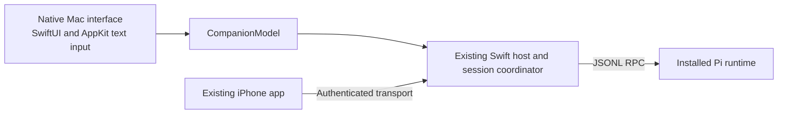

# Pi-like native Mac interface

## Goal

Recreate the interface seen when running `pi-coding-agent` in Terminal as a native Swift Mac interface. Match its layout, visual density, prompt editing, completion, keyboard behavior, conversation and supported dialogs as closely as the protocol and native platform permit.

The terminal Pi interface is the design reference. The current workspace-first Mac window is not the reference. Similar functions behind a different layout do not meet this goal.

Status: implementation and automated verification are recorded in [Mac redesign verification](../pi-like-mac-verification.md). The plan remains incomplete. The user has supplied startup and extension-widget/footer references and rejected the first native layout. The follow-up uses those references. Other terminal-state captures, normal-launch interaction checks and final user visual acceptance remain open. Keep this plan until those checks pass; no acceptance is inferred from source inspection or hosted captures.

## Context

Verified repository and local package evidence:

- Installed `@earendil-works/pi-coding-agent` and `@earendil-works/pi-tui` report version 1.3.0. This is the initial reference, not a supported-version range.
- `Apps/macOS/CompanionWindow.swift` implements the workspace sidebar, conversation destination, inspector and native pickers.
- The pre-redesign `Apps/Shared/ConversationView.swift` remains the phone/shared fixture view. The Mac now uses `Apps/macOS/PiConversationView.swift` and `PiEditor.swift`.
- `Apps/macOS/PiRemoteMacApp.swift` defines the main window and menu-bar entry.
- `Apps/macOS/CompanionModel.swift` connects local controls to existing host state and session actions.
- `docs/native-compatibility.md` records existing RPC support and limits. Typed shell actions, Mac controls and bounded streaming are implemented; native workflow acceptance remains open.
- `project.yml` defines the `PiRemoteMac` scheme and `PiRemoteMacTests`. It also includes `Apps/Shared` in the iPhone app.

This plan changes the Mac presentation target. It does not authorize a TypeScript backend, embedded terminal, upstream modifications or extension-specific adapters. Existing RPC coverage requirements remain. Protocol limits must be recorded, not presented as implemented behavior.

## Architecture



- Implement the Mac presentation in `Apps/macOS`. Use AppKit through Swift where text editing or keyboard handling requires it.
- Reuse host state, actions, process supervision, session storage and authentication. Do not start a second runtime for the new interface.
- Keep reusable transcript parsing in shared code. Separate Mac presentation from shared views when needed to preserve iPhone behavior.
- Keep Files, workspace selection, import/export, pairing and settings accessible as secondary controls. They must not dominate the main coding interface or be removed.
- Preserve session-bound actions, confirmation requirements, bounded output, draft consent and unknown-outcome handling. Never resend uncertain work to imitate terminal behavior.

## Non-Goals

- An ANSI renderer, PTY, terminal emulator or embedded terminal.
- Importing or porting `pi-tui` into Swift, or changing the Pi agent engine.
- Pixel-identical terminal font rasterization or every terminal theme.
- Generic execution of arbitrary terminal extension components.
- Concurrent runtimes, terminal-session attachment, automatic history import or an iPhone redesign.
- Native replicas of every terminal-only management workflow in this iteration. Record exclusions explicitly during reference review.

## Plan

### 1. Establish the reference and acceptance boundary

- [x] Inspect installed Pi interactive components, editor, keybindings, theme and renderer documentation; record the effective runtime version, fullscreen/regular mode, theme and relevant non-secret settings in a focused interface reference document. Evidence: source paths and a behavior table; do not inspect or copy credentials.
- [ ] Obtain reference captures of the user's normal Pi interface for startup, idle editing, completion, active output, tools, selectors and errors. Use synthetic fixture content and no provider request where possible. Evidence: reviewed captures with window dimensions and text size; ask for user-provided captures if normal interactive inspection is unavailable. Do not start an interactive process through Bash.
- [x] Compare each reference interaction with current Mac behavior and the RPC contract. Record the reference action, expected result, current result, target behavior, validation method and any deliberate difference. Include keyboard precedence, queued-input recovery, data needed by the startup/footer, shell execution and session-tree navigation. Evidence: every selected workflow has a supported implementation path or an explicit limitation.
- [x] Establish the target layout from the user's supplied normal-startup and extension-widget/footer references and record its behavior table in the reference/research documents. The requested structure is explicit: Pi startup/resources, compact ruled input, footer and extension-aware placement. The user authorized source research. No adapter or upstream change was added; final native visual acceptance remains a separate open check.

### 2. Build the native Pi-like main surface

- [ ] Replace the default workspace-first conversation presentation with the approved transcript/editor/footer layout. Make workspace and inspector functions secondary while preserving access. Evidence: deterministic startup and populated-session captures match the approved reference structure at normal and narrow window sizes.
- [ ] Implement Pi-like typography, spacing, semantic colors, separators and status placement in the Mac presentation. Use the selected reference theme rather than adding a general theme system. Evidence: side-by-side capture review confirms the visual hierarchy and density; text remains readable and selectable.
- [ ] Render user and assistant messages, Markdown, thinking, tool activity, images, errors and truncation notices in the approved style. Preserve stable identities and reading position during streaming. Evidence: fixtures cover partial/final output, long lines, large tool results, collapsed/expanded content and scroll-follow pause/resume.
- [x] Implement startup information and the status footer using available authoritative state. Do not substitute invented values for unavailable model, context, token, cost or resource information. Evidence: empty, active, retry, compaction, interrupted and unavailable fixtures show accurate state and explicit unavailable values.

### 3. Match editing and interaction

- [ ] Implement the approved Pi editor key map, including Enter submission, modified-Enter newline, history navigation, completion precedence, selection and Escape behavior. Preserve IME composition and multiline paste. Evidence: focused Mac input tests plus normal-app keyboard checks; composing text never submits prematurely.
- [x] Implement slash-command suggestions and file/path completion with Pi-like placement and navigation. Keep completion separate from execution and apply existing directory permissions and attachment limits. Evidence: tests cover spaces, Unicode, no matches, cancellation, stale session results and failed submission without losing the draft.
- [x] Match steering, follow-up, queued-input editing and Stop behavior where supported. Resolve differences between Pi's queue recovery and the host's current queue-clearing Stop before changing semantics. Evidence: fixture and coordinator tests verify queue order, recovered text, draft preservation and no duplicate dispatch; unavailable recovery is explicit.
- [ ] Present model/thinking selection, supported settings, session pickers and standard extension UI in the approved Pi-like interaction style. Preserve timeout, cancellation, stale-context rejection and draft-replacement consent. Evidence: keyboard-only checks and focused tests cover select, confirm, input, editor, status/widget updates and editor offers.
- [ ] Add Pi-like direct shell entry through existing upstream `bash`/`abort_bash` RPC, including the approved handling of `!` and `!!`. Keep execution confirmation and model-context inclusion explicit. Evidence: isolated host fixtures verify output streaming, cancellation, final results, stale-session rejection, bounded output and uncertain outcomes without replay; normal-app review verifies the native presentation.
- [x] Keep unsupported terminal-only commands and custom extension interfaces explicit. Do not send known unsupported built-in actions as ordinary model prompts. Evidence: command-routing tests preserve drafts and show actionable errors; the compatibility table lists remaining differences.

### 4. Verify normal Mac use and document the result

- [x] Add focused tests under `Tests/MacTests` and affected host/shared test targets for the changed input, presentation and action routing. Update `project.yml` test sources if Mac-only files are added. Evidence: relevant tests pass; old workspace assumptions are replaced rather than disabling unrelated coverage.
- [ ] Build and test the Mac scheme using the configured commands below. Launch the built app through the normal Mac launch path and check local session creation/resume, editing, output, tools, selection, Stop and recovery with approved fixtures. Evidence: recorded command results and manual checks; no phone listener is required for local use.
- [ ] Review paired terminal and Mac captures against the approved reference with the user. Record each remaining visual or behavioral difference and obtain acceptance for those retained. Evidence: user confirms that the native Mac interface feels like their terminal Pi interface.
- [x] Run focused host/shared regressions for changed actions. If shared presentation, protocol or host semantics affect the phone, run a relevant smoke check on the iPhone 17 Pro simulator, iOS 26.5. Otherwise record why a phone check is not applicable. Evidence: named checks and results; no broad device matrix.
- [x] Update `README.md`, `PLAN.md`, `docs/mac-interface.md` and `docs/native-compatibility.md` to describe the implemented Mac behavior, shortcuts and remaining limits. Run `git diff --check` and verify local links. Evidence: documentation matches the accepted interface and distinguishes new results from historical checks.

### Configured Mac checks

These commands are defined by `project.yml` and documented in `docs/native-apps.md`. They are planned checks, not results from drafting this plan. During implementation, run focused test selections first and record the selected tests and outcomes.

```sh
export DEVELOPER_DIR=/Applications/Xcode.app/Contents/Developer
xcodegen generate --spec project.yml
xcodebuild -quiet -project PiRemote.xcodeproj -scheme PiRemoteMac \
  -destination 'platform=macOS,arch=arm64' \
  -derivedDataPath /tmp/pi-remote-pi-like-mac CODE_SIGNING_ALLOWED=NO build
xcodebuild -quiet -project PiRemote.xcodeproj -scheme PiRemoteMac \
  -destination 'platform=macOS,arch=arm64' \
  -derivedDataPath /tmp/pi-remote-pi-like-mac CODE_SIGNING_ALLOWED=NO test
git diff --check
```

Do not claim normal-launch success from a build or model test alone. Provider calls, clipboard writes, exports and other external effects need the applicable approval; use isolated fixtures by default.

## Execution record

- The user authorized implementation from this saved plan on a new branch with a pull request. No repeat approval was requested for the native Pi-like direction or existing security requirements. Final visual acceptance and retained differences have not been approved by inference.
- Branch: `narumi/feat/pi-like-mac-interface`, from `main` at `ba98b83` (equal to `origin/main` at branch creation). Pre-existing in-scope README/PLAN/draft-plan changes were retained.
- Implementation commit: `889fe3a`. Delivered as [draft pull request #8](https://github.com/narumiruna/pi-remote/pull/8). The draft state records incomplete attended acceptance, not a completed redesign plan.
- [Source reference and behavior matrix](../pi-like-mac-reference.md): Pi 1.3.0, dark/regular, thinking collapsed; no live terminal captures. Twenty deterministic library render checks are not screenshots.
- New Mac surface: `Apps/macOS/PiConversationView.swift`, `PiEditor.swift`, `PiPresentation.swift`, `PiConfigurationPicker.swift` and `PiExtensionDialog.swift`. Existing session management and the iPhone layout remain.
- Shell and queue recovery: typed session actions, bounded correlated output, repeated cancellation, conservative unknown outcomes, caller-only recovered input and saved shell projection. Security/lifecycle findings were fixed and regression-tested; see the [verification record](../pi-like-mac-verification.md).
- Final root checks: 188 functions pass. All 114 integrated Mac tests pass without skips. Shared checks: 52 pass normally and with Thread Sanitizer. Focused sanitizer selections of 19, 28 and 27 functions pass; selections overlap. Three primary-phone product smoke checks pass. The final opt-in installed-Pi shell check passes. Local links and `git diff --check` pass. A broader 69-test sanitizer attempt failed at fixture startup and remains recorded as failed evidence.
- Open checkboxes that include visual comparison, normal-app keyboard use or user acceptance remain open even where their implementation and hosted fixtures exist. Native captures are local temporary artifacts; no binary screenshots are committed.
- An existing normal Mac app instance was left unchanged. Do not stop personal work or treat hosted fixture windows as proof of a normally launched product coding session.
- Screenshot follow-up: the user provided a normal startup reference and an extension progress/footer crop. Source research confirms standard text widgets/statuses/severity are transported, but custom Starship footer/header/editor factories are not. See [extension research](../pi-extension-native-display.md). The implementation now preserves generic typed display slots, keeps the startup header after prompts, uses one content flow and grows input from 34 to 180 points. Context paths remain explicitly unavailable; skills/prompts use RPC discovery. No screenshot values are hardcoded.
- Follow-up host checks: 193 root tests, 54 shared tests normally and with Thread Sanitizer, and focused metadata sanitizer checks pass. The Mac captures now verify startup/input/footer geometry and standard extension placement. All 127 Mac tests, the final unsigned Mac build, the iOS simulator build and three phone smoke checks pass. All 142 local documentation links and `git diff --check` pass. The [verification record](../pi-like-mac-verification.md) separates these results from normal-app/user acceptance; earlier PR counts above remain historical checkpoints.

## Risks

- The user's effective theme, extensions and keybindings may differ from package defaults. Establish the actual reference before visual implementation.
- RPC does not expose arbitrary custom terminal components or all terminal management operations. Resolve required gaps before promising parity.
- Current bounded state may not expose every startup/footer or queue detail. Add only the typed state required by accepted behavior, with tests and no sensitive diagnostic logging.
- Shared conversation changes can alter the phone interface. Keep Mac-specific code separate where necessary and test affected shared boundaries.
- A literal terminal copy can reduce native text editing or accessibility quality. Retain native selection, IME, focus and accessible labels while matching the approved interaction.

## Rollback / Recovery

- Do not migrate, rewrite or delete existing sessions, drafts, credentials, pairing records or workspace preferences for this presentation change.
- Keep new UI state local and non-destructive; do not add a runtime feature flag solely for rollback.
- If a change breaks normal launch, editing or action routing, revert the in-scope code change while preserving user data. Confirm session resume and no prompt replay before proceeding.

## Completion Checklist

- [ ] All plan tasks have passing evidence or an explicitly accepted not-applicable disposition.
- [ ] The approved Pi terminal reference, behavior table and comparison captures are recorded without secrets or personal conversation data.
- [ ] The default Mac coding surface matches the approved terminal layout and interaction; workspace controls are secondary and existing features remain accessible.
- [ ] Focused input, presentation and action tests pass; the normally launched Mac app passes the agreed workflow checks.
- [x] No embedded terminal, PTY, TypeScript backend, extension-specific adapter, security regression or automatic replay was introduced. Evidence: complete source review, isolated shell/RPC/lifecycle regressions, normal root checks and focused sanitizer checks; no transport authentication or certificate checks were weakened.
- [ ] Required phone checks pass or their non-applicability is recorded; unresolved protocol differences have explicit user acceptance.
- [ ] Documentation and local links are correct, `git diff --check` passes, and the user accepts the resulting resemblance to terminal Pi.
