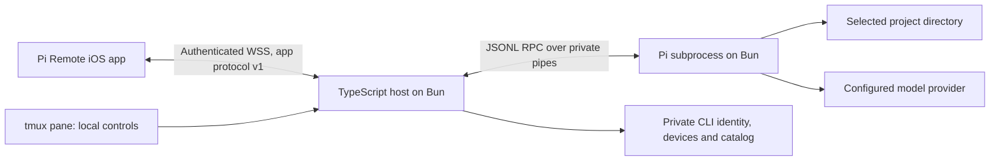

# TypeScript headless CLI

## Goal

Provide a small foreground `pi-remote` service for macOS and Linux. A user runs it from a tmux pane in a folder such as `~/src` or `~/projects`, connects the Pi Remote iOS app, selects a project and uses Pi on that computer without opening the Mac app.

Status: implementation and acceptance checks pass. The user approved execution of the reduced first milestone. Git handoff remains open below; delete this active plan after that handoff. Durable results are in [the verification record](../headless-cli-verification.md).

## Agreed decisions

- Use TypeScript and Bun for the CLI runtime. Pi can also run with Bun.
- Use npm for dependency management and package installation, with `package.json` and `package-lock.json`. Do not introduce another package manager or lockfile.
- Use Biome for formatting, lint and import organization. Use the TypeScript compiler for full type checking.
- Use Husky for `pre-commit`. Keep `.husky/pre-commit` to one line:

  ```sh
  node ./scripts/pre-commit.mjs
  ```

  - The user permits this alternative to the inspected template's `./scripts/pre-commit.sh`.
  - Put checks in `scripts/pre-commit.mjs`. Node.js runs this development hook; it is not the CLI or Pi runtime requirement.
- Treat the working directory as the initial phone browsing location, not an approved-root restriction or a Pi tools sandbox.
- Startup does not create or resume a Pi session. Choose the project and activate a session explicitly from iOS.
- Keep the existing Mac app available. Do not replace its implementation or share its writable session catalog with the CLI.

## Context

Verified by source inspection:

- `Packages/PiRemoteCore/Sources/PiRemoteCore/AppProtocol.swift`, `AppState.swift` and `ConnectionIdentity.swift` define the existing version-1 app contract, snapshots and pairing format.
- `Packages/PiRemoteHost/Sources/PiRemoteHost/AppServer.swift` and `DeviceRegistry.swift` contain the existing authentication and local-approval behavior. `Packages/PiRemoteClient/Sources/PiRemoteClient/RemoteClient.swift` is a production client for compatibility checks.
- Swift `Codable` enum envelopes, Base64 data, Foundation date encoding and UUID representation are part of the wire contract. TypeScript types alone do not establish compatibility.
- The iOS client synchronizes after authentication. Some phone controls use capabilities, but not every action is capability-gated. A reduced host cannot assume that advertising fewer capabilities hides every unsupported control.
- `/Users/narumi/src/typescript-template/.husky/pre-commit` contains one line: `./scripts/pre-commit.sh`.
  - That template's script runs Biome migration and write operations. Copy the hook structure, not those side effects. The proposed hook below is check-only.
- The installed Pi RPC documentation describes a subprocess boundary and recommends its exported TypeScript `RpcClient` for TypeScript clients.
  - The inspected installed `RpcClient` starts `node` explicitly and forwards child stderr. This is a helper implementation choice, not a Pi runtime restriction. Do not adopt it unchanged if it would change the Bun runtime or private-log requirements.
- The approved Swift CLI cleanup is complete. Its files are preserved in `/tmp/pi-remote-paused-swift-cli.bd2jo5` and `/tmp/pi-remote-paused-swift-cli.patch`; native host source and unrelated work are preserved.
- A Docker Linux runner was made available. Both root and non-root checks pass with an isolated Secret Service; Linux support is not inferred from Mac tests.

## Architecture



- Keep the phone-facing app protocol separate from upstream Pi RPC. Do not expose arbitrary RPC forwarding to the phone.
- Keep one loaded Pi process per CLI catalog. Reject concurrent writers to that catalog.
- Use a Bun-launched Pi subprocess for process isolation and explicit cleanup. Verify the installed Pi entry point and arguments instead of relying on its shebang to select the runtime. Do not use shell interpolation.
- Prefer a small RPC adapter using upstream type definitions. Use an upstream runtime client only if its Bun launch, bounded I/O, error handling and diagnostic behavior pass the same checks. Do not fork Pi or switch to its in-process SDK without reviewing that boundary change.
- Bind one selected private LAN, Tailscale or loopback IPv4 address. Reject public and wildcard addresses. Require an explicit choice when available interfaces are ambiguous.
- Require pinned TLS identity, short-lived pairing, explicit local approval bound to the displayed request, per-device authentication and immediate revocation.
- Store CLI identity and sessions separately from the GUI and terminal-owned Pi sessions. Keep provider credentials in Pi's host configuration.
- Keep ordinary output bounded and free of credentials, pairing grants, prompts and tool output. Show a pairing code only through an explicit local action. A blocked terminal or slow phone must not prevent shutdown or Pi output draining.
- Detaching tmux leaves the host running. Graceful exit stops its listener and managed child. A phone disconnect does not stop accepted work.

### Implemented package layout

Use one npm package at the repository root. Do not add npm workspaces for one package.

- `package.json`, `package-lock.json`, TypeScript configuration and `biome.json`: package and development checks.
- `src/cli.ts`: command entry point and terminal controls.
- `src/host/`: app protocol, transport, authentication, directory access, session coordination and Pi adapter. Split files by responsibility only when useful.
- Co-located `*.test.ts` files: focused Bun tests. Do not create a lowercase `tests/` directory alongside the existing `Tests/` on case-insensitive filesystems.
- `scripts/pre-commit.mjs` and `.husky/pre-commit`: development hook.
- `dist/`: generated npm CLI entry and required runtime files, not a native executable bundle.

These approved paths are implemented. `Spikes/CLIClientCheck` and `src/fixtures/` are explicit verification tools, not runtime helpers in the npm artifact.

## Accepted first milestone

Deliver the complete parent-folder-to-coding flow before attempting host feature parity:

- Pair, authenticate, list devices, reject pairing and revoke access.
- Read the initial snapshot, synchronize and browse directories from the launch folder, including parent navigation and explicit paths.
- List CLI-managed sessions; create, explicitly resume and close one session in its saved directory.
- Send prompts, stream text/thinking/tool activity, send steering/follow-up and Stop. Stop clears queued input before aborting and confirms the final state.
- Discover/select models and thinking levels, and answer supported standard extension dialogs without automatic approval.
- Reconnect without duplicate prompt dispatch; restore saved sessions explicitly after host restart and identify interrupted or uncertain work.

The finite [action compatibility table](../headless-cli.md#action-compatibility-table) maps implemented and deferred actions and phone guards. Unimplemented actions return `unsupportedFeature`; native-host features remain available. This milestone does not claim complete upstream RPC coverage.

## Plan

### 1. Approve scope and resolve implementation risks

- [x] Review this plan with the user, including the first-milestone action list, proposed layout and storage policy; record acceptance before changing implementation files.
- [x] Inventory the paused Swift prototype and propose exact removals or reversions. Obtain approval before destructive cleanup; preserve the requested `AGENTS.md`/`PLAN.md` language-rule changes and all unrelated work. Evidence: reviewed, path-specific diff.
- [x] Map app actions, mandatory snapshot fields, capabilities and visible iOS controls to the first milestone. Evidence: finite compatibility table with implemented, deferred and phone-guard requirements; no implicit feature claims.
- [x] Select the Pi integration after reading the installed RPC commands, events, extension UI and session-format references. Prove Bun launches the installed Pi in a selected directory, receives state and exits cleanly without relying on Node to execute Pi. Evidence: isolated subprocess spike on macOS and Linux, without provider requests or routine stderr logging.
- [x] Resolve the host secret-store policy before persisting credentials: preserve macOS Keychain protection through a reviewed integration; identify a Linux store or request explicit approval for private on-disk storage. Evidence: documented threat model, ownership/mode/symlink checks and clear at-rest protection limits. Do not describe private files as encrypted storage.
- [x] Prove the chosen Bun TLS/WebSocket and filesystem APIs meet iOS certificate pinning, hostname/validity checks, stale-directory detection and single-writer requirements on both platforms. Evidence: focused spikes and negative tests; report unsupported filesystems instead of silently weakening checks.

### 2. Establish npm tooling and the single-line hook

- [x] Add the approved npm package, lockfile, Bun types and strict TypeScript configuration without changing Swift app targets. Evidence: clean dependency installation and full typecheck pass.
- [x] Add Biome configuration scoped to the TypeScript package and relevant configuration files, excluding Swift build output and generated artifacts. Evidence: formatting/lint checks detect intentional fixture violations without scanning unrelated app code.
- [x] Define npm scripts for checks, format, typecheck, tests and package build. Checks use Biome; typecheck checks the whole TypeScript project with the compiler's no-emit mode; tests run with Bun. Evidence: each script passes from the package root. These are planned scripts, not currently verified repository commands.
- [x] Add the exact one-line Node hook and its `.mjs` script. Resolve the repository root from the script location, run local installed tools, propagate failure and never download tools, auto-migrate, rewrite files or stage changes. Evidence: staged-file Biome check, whole-project typecheck, failing-hook cases and an unchanged worktree/index after checks.

### 3. Establish the app protocol and secure connection

- [x] Create Swift-generated JSON contract fixtures for pairing, authentication, requests, replies, snapshots and faults, including dates, enum envelopes, Base64 data and UUIDs. Evidence: TypeScript decodes Swift output and the production Swift client decodes TypeScript output. Cover sequence-number bounds without JavaScript precision loss.
- [x] Add bounded runtime validation for inbound messages and version rejection. Evidence: malformed, oversized and unsupported-version fixtures fail before filesystem or Pi access.
- [x] Implement persisted server identity, exact-interface WSS binding and the approved secret store. Evidence: identity survives restart; wrong pin, hostname, validity and public/wildcard binding tests fail closed.
- [x] Implement local pairing controls and device revocation. Evidence: no startup pairing grant, no access before explicit approval, stale/wrong request rejection, expiry/rate limits, replay rejection and revoked live/reconnection denial.

### 4. Implement directory and Pi session control

- [x] Implement bounded authenticated browsing with the launch directory as the nil-selection default. Evidence: both `src`-style and `projects`-style parent fixtures open correctly; startup creates no Pi session; nested, parent, symlink, denied, deleted and replaced-path tests pass.
- [x] Implement the managed catalog, opaque session/directory IDs and single-writer ownership. Evidence: a second writer is rejected; creation/resume validates directory identity; no GUI or terminal-owned session is opened for writing; failed startup releases resources.
- [x] Implement Bun subprocess startup, strict LF JSONL framing, response correlation, deadlines, bounded writes and continuous stdout/stderr draining. Evidence: split UTF-8, CRLF, Unicode separators, malformed output, blocked stdin, child crash and cancellation tests pass without leaking stderr or replaying commands.
- [x] Implement first-milestone actions and transcript reduction. Evidence: prompt acceptance is distinct from completion, `agent_settled` determines idle, final messages replace deltas, tool errors stay visible and expired/session-stale dialogs cannot be answered.
- [x] Implement deduplication, epoch/session binding, bounded replay and snapshot recovery. Evidence: reconnect delivers each accepted prompt once; stale contexts fail; unknown outcomes remain explicit; host restart requires explicit session activation.
- [x] Implement shutdown for local quit, stdin EOF, SIGINT, SIGTERM and startup failure. Evidence: listener and child exit within a defined tested deadline, terminal backpressure cannot block cleanup, and child signal dispositions remain correct. Record forced-termination limits separately.

### 5. Verify the product flow and npm artifact

- [x] Run focused unit, contract, TLS, permission and process checks on macOS and an actual Linux runner. Evidence: recorded platform/tool versions and passing results; no Linux support claim based only on Mac tests.
- [x] Connect the production Swift client to the TypeScript host on each platform and exercise pairing, parent/nested browsing, controlled coding, steering/follow-up, Stop, reconnect, revocation and restart. Evidence: expected project file changes, one prompt dispatch and confirmed cleanup. A fixture is not a real-provider result.
- [x] Run a focused iPhone 17 Pro simulator smoke check for pairing, project selection and one coding/reconnection flow. Test any necessary capability guards and host-neutral wording. Do not run the retired compact-device matrix.
- [x] Verify the packed npm artifact in a temporary clean directory: installed command entry, Bun shebang, executable mode, required files and actionable missing-runtime/Pi errors. Evidence: tarball inspection and local installation test; no secrets, fixtures, build caches or Swift prototype artifacts in the package. Do not publish to the registry without approval.
- [x] Write actual usage, security/storage limits, tested platforms and verification commands in README and focused CLI documentation; link this plan from `PLAN.md`. Run `git diff --check`. Do not publish installation or support claims before their checks pass.

### 6. Complete the Git handoff

- [ ] Commit the verified, in-scope changes, push the branch and open the pull request. Evidence: clean worktree and PR URL.

## Completion Checklist

- [x] The user has accepted the plan and the reduced first-milestone scope; material storage and integration decisions are resolved.
- [x] An npm-installed TypeScript CLI runs on Bun on tested macOS and Linux environments, without the Mac GUI or a Swift runtime helper.
- [x] Starting in either a `~/src`-style or `~/projects`-style parent folder lets iOS select a real project before Pi starts.
- [x] TLS, explicit local approval, device authentication/revocation and directory/session validation pass their negative checks.
- [x] Coding, streaming, Stop, reconnect, explicit restart recovery and resource cleanup pass the defined checks without prompt replay.
- [x] The Husky hook is one line; Biome and full typecheck failures block commits without rewriting or staging work.
- [x] The npm artifact passes clean local installation; unsupported app actions are explicit and correctly guarded.
- [x] Verification records distinguish fixtures from real Pi/provider checks and local tests from hardware/off-site behavior.
- [x] Approved Swift prototype cleanup is complete, unrelated app behavior is preserved, and documentation matches verified results.

- [ ] Finish the authorized Git handoff and remove this completed active plan. Keep usage and verification in durable documentation.

## Rollback / Recovery

The reviewed Swift prototype cleanup is complete and backed up. Do not reset unrelated work or restore the removed language rule.

The new CLI starts with an independent identity and catalog. Do not migrate or delete GUI state, terminal Pi history or provider credentials. Back up CLI metadata before any later format migration. Stop the host before replacing its runtime or accessing its managed session files. Retain its identity for paired-device reconnection; identity replacement requires explicit re-pairing, never relaxed TLS checks. After interrupted work, inspect its outcome before retrying. Local npm packing/installation does not authorize a registry release.
